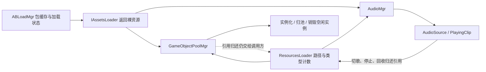

# AB、对象池、音频联合生命周期审查

日期：2026-11-05。源码基线：`69aa186ea4431722ce352610896efe8cb351964c`。

原审查阶段只审查和复现，未修改 Runtime/Editor 的实现、场景或资源。结论为 **8 项 P1、3 项 P2**；其中对象池 Resources 引用归还属于原文档已声明的责任缺口，AB 全局卸载属于需要明确范围的集成风险，不能都当作新发现的实现错误。

后续修复已按建议顺序落地，见 [修复记录与正常行为回归结果](FIXES.md)。本文件保留审查时的代码位置和观测值，不代表修复后的当前行为。

## 范围与当前调用关系

完整检查三个主实现：`ABLoadMgr.cs`、`GameObjectPoolMgr.cs`（含 PoolData）、`AudioMgr.cs`。沿调用链检查 `ResourcesLoader`、`IAssetsLoader`、`AssetsLoader`、`ABSourcesRelated`，以及单例、PublicMono 和启动入口中相关生命周期路径。本轮不覆盖已废弃的 FTP 热更实现、完整网络协议、所有玩法和所有平台。

核心断点：AB 的两套异步实现没有统一操作所有权；池和音频拿到的主要是裸资源，清理时缺少跨模块统一的失效代次与持有凭据。单纯增加 Clear 或 Stop 调用次数无法解决这些问题。

## P1：优先修复

### 1. 依赖包错误地继承目标包加载位置

- **位置**：`Runtime/Manager/AssetsMgr/AssetBundleMgr/ABLoadMgr.cs:491`、`:531`；`SetABSourcesRelated` 在 `:109` 接收清单，但依赖加载未使用其中逐包的 loadPath。
- **触发**：目标包在 PersistentDataPath，依赖包在 StreamingAssetsPath（或其它混合位置）。
- **实际结果**：依赖包也从 PersistentDataPath 查找，导致依赖和目标资源加载失败。
- **实测**：AB-01。真实主包初始化成功；依赖从 StreamingAssets 文件能单独加载；经管理器加载目标包则返回 null。
- **修复方向**：每个依赖独立解析清单中的位置；缺少依赖配置时明确失败或执行有文档的兼容规则，不隐式沿用父包位置。

### 2. Task 与回调加载没有共享并发状态

- **位置**：`ABLoadMgr.cs:240`、`:246` 对比 `:340`。
- **触发**：同一帧通过 Task API 和回调 API 加载同一个尚未缓存的包。实际可由对象池 Task 加载与音频回调加载交叉触发。
- **实际结果**：Task 路径使用 _loadingBundles，协程路径绕过该集合，两者可以重复发起原生加载。
- **实测**：AB-02。真实 AB 同时请求，Task 成功，回调收到 null；Unity 报相同文件的 AssetBundle 已被加载。
- **修复方向**：共用一个按来源/包名/版本标识的进行中操作；回调接口只作为同一 Task 的适配层。

### 3. ClearAB 后旧 Task 仍会写回缓存

- **位置**：`ABLoadMgr.cs:666`，尤其 `:668`、`:672`，关联异步加载完成后的缓存写入。
- **触发**：远程包仍在下载时调用 ClearAB。
- **实际结果**：只停止协程并清空集合，没有取消 Task 持有的请求或检查失效代次。旧请求之后又把包放回字典。
- **实测**：AB-03。受控延迟 HTTP 返回后，缓存重新出现 2 个包，但 IsInitialized=false。
- **联合影响**：池/音频继续持有旧 IAssetsLoader；外层 `AssetsLoader.ClearAB()` 也未同步重置自己的 IsInitialized，出现“外层仍就绪、底层主包已清空、旧请求又成功”的不一致状态。
- **修复方向**：Clear/Dispose 首先使上下文失效，终结所有等待者；迟到的原生结果只清理、不入库。清空与重新初始化必须有明确的状态转换。

### 4. 协程宿主销毁会让回调永久没有结果

- **位置**：`ABLoadMgr.cs:565` 的回调入口、`:604`/`:629` 的资源回调链；本类未实现清理进行中加载的 OnDestroyed 钩子。
- **触发**：回调式远程加载进行中销毁 ABLoadMgr。
- **实际结果**：Unity 停止协程，调用者既不收到资源，也不收到 null/取消结果。
- **实测**：AB-04。销毁宿主后，超过受控服务器的响应延迟仍没有回调。
- **联合影响**：音频加载回调可能不结束；任何以回调包装 Task 的业务流程也可能一直等待。
- **修复方向**：将等待者注册到加载操作中，销毁/取消时完成一次终态通知，避免只 StopAllCoroutines。

### 5. Dispose 后的预热任务能够复活旧对象池

- **位置**：`Runtime/Manager/ObjPool/GameObjectPoolMgr.cs:369`、`:386`、`:407`。
- **触发**：Prewarm 等待资源时 Dispose；之后资源才加载完成。
- **实际结果**：没有 disposed 状态或代次检查，续体仍然实例化、入池和重建根节点。
- **实测**：POOL-02。Dispose 后完成延迟加载，旧管理器重新持有 2 个空闲对象。
- **修复方向**：区分“只清空当前空闲项”的 Clear 和“终止管理器生命周期”的 Dispose；后者必须使旧任务失效并处理迟到资源。Clear 对在途请求的语义也应明确。

### 6. IPoolable 异常会破坏对象池状态

- **位置**：`GameObjectPoolMgr.cs:339` 先加入 pooledObjects；`:55` 调用 OnDespawn；出池的 `:79`/`:92` 与 `:425` 同样存在先执行用户代码、后完成管理器状态更新的问题。
- **触发**：OnDespawn 抛异常，然后调用方重试归还。
- **实际结果**：对象仍激活、没有入栈，却已被标记为“在池中”；后续正常归还被重复入池保护拒绝。
- **实测**：POOL-03。第一次归还抛异常，第二次归还被拒绝，池内数量为 0，重复保护集合却包含该实例。
- **修复方向**：出入池采用明确状态转换；用户回调异常时回滚或销毁并释放，不能留半提交状态。另需补测 OnSpawn 异常和回调重入。

### 7. 直接播放入口未使旧异步音频请求失效

- **位置**：`Runtime/Manager/AudioMgr/AudioMgr.cs:295`、`:531`；对比字符串入口 `:272`、`:505` 的序号递增。
- **触发**：先请求异步 BGM/唯一音效，再调用 AudioClip 重载直接播放另一段声音；旧请求最后完成。
- **实际结果**：直接播放没有推进对应请求序号，旧回调仍被接受并覆盖最新播放意图。
- **实测**：AUDIO-01、AUDIO-02，BGM 和唯一音效两条路径均成立。
- **修复方向**：在所有播放入口统一处理请求失效；包含直接 AudioClip 入口和“同一首不重启”的提前返回分支。

### 8. StopAllSound 无法阻止待加载叠加音效随后播放

- **位置**：`AudioMgr.cs:585`、`:601`、`:673`。
- **触发**：LoadSoundAndPlay 仍在加载时 StopAllSound。
- **实际结果**：停止只处理现有 soundList 与唯一音效的请求序号；叠加音效回调只判断 clip/audioRoot，没有停止代次。
- **实测**：AUDIO-03。StopAllSound 后完成旧加载，回调获得有效 AudioSource，PlayingSoundCount 变为 1。
- **修复方向**：为叠加音效增加统一停止/释放代次，迟到资源归还并以 null 完成回调。Dispose 后重新创建 audioRoot 的情况也应覆盖，不能只靠 root 是否存在判断请求有效性。

## P2：集成边界与次级问题

### 9. ClearAB 卸载的是应用内所有包，而不只是本管理器拥有的包

- **位置**：`ABLoadMgr.cs:669`，使用 AssetBundle.UnloadAllAssetBundles(false)。
- **实测**：AB-05。绕过本管理器独立加载 audit_external，再调用 ClearAB，外部 AssetBundle 容器也被卸载。
- **判断**：这是明确的全局影响；若项目有第三方加载器或独立模块，会互相干扰。若产品意图本来就是全局重置，需要明确命名、文档与调用约束。
- **修复方向**：默认按本管理器所有权逐包卸载，真正的全局清理独立暴露。这里使用 Unload(false)，本次证据只证明包容器失效，不能据此声称所有已加载材质/音频都会立即被销毁。

### 10. 对象池增加 Resources 引用，却不记录对应释放责任

- **位置**：`GameObjectPoolMgr.cs:264`、`:314`、`:489` 增加资源引用；`:386` 清理不归还，模块内没有 UnLoadAsset 调用。
- **实测**：POOL-01。归还并 Clear 后，池内数量为 0，预制体 Resources 引用计数仍为 1。
- **判断**：原 README 已明确 Clear 不负责卸载资源，不能当作违反现有 Clear 约定的新缺陷。但框架调用方必须自行统计每次池空加载、同步加载、预热等产生的引用，缺少可配对的持有记录。
- **修复方向**：建立按池条目持有的预制体凭据，明确空闲实例和借出实例各自的生命周期；Clear 不应因释放共享预制体而影响仍在使用的实例。超时、迟到结果、外部 Destroy 和预热超限销毁一并纳入释放表。

### 11. PublicMono 重建后音频不重新注册更新

- **位置**：`AudioMgr.cs:172`，updateRegistered 只保存 bool，未保存或核对实际调度宿主。
- **触发**：PublicMono 被销毁重建后，再请求音频淡变。
- **实测**：AUDIO-04。新的 PublicMono 监听者为 0，若干帧后 bgmFadeElapsed 仍为 0。
- **影响**：淡变与自动音效回收停滞；正常切场景因为 PublicMono 常驻，不一定触发，因此列为 P2。
- **修复方向**：记录注册到哪个 PublicMono；宿主更换后重绑，或将更新生命周期绑定到音频根节点，避免布尔状态冒充有效订阅。

## 未确认的共享 AudioClip 假设

CROSS-CHECK：池通过 Resources 加载带 AudioSource 的预制体，音频管理器通过独立路径加载同一 AudioClip。确认两者实际引用同一原生对象后，停止唯一音效。

结果：直接 AudioClip 引用计数变为 0，但原对象及池实例上的 AudioSource.clip 仍有效，等待 2 帧后也有效。因此 **没有把“StopUniqueSound 会立即破坏池中 AudioClip”列为已确认缺陷**。这项结果仅覆盖本次 Unity/Windows 夹具，不证明所有资源类型、所有卸载路径或所有平台都安全；原生内存何时回收仍需 Profiler 验证。

## 现有有效机制

- AudioMgr 的字符串 BGM/唯一音效请求已有序号，停止这两类请求也会推进序号；应扩展覆盖入口，而非推倒重写。
- 常规音效停止/回收路径先停播、解除 clip 再归还 Resources 引用。
- 对象池常规归还已带同一实例重复入池保护，也跳过外部销毁的空闲对象；当前问题在异常/重入和所有权边界。
- ResourcesLoader 已具备失败删除缓存、回调异常隔离和清空结束等待者的机制；AB 应对齐类似终态保证。

## 建议修复顺序与验收

### 第一批：AB 加载操作统一

1. 两套 API 共用进行中操作与结果，逐依赖解析位置。
2. 增加上下文代次；Clear/销毁让旧操作终结，迟到包不得写回。
3. 统一底层与 AssetsLoader 就绪状态，限制卸载范围。

验收：同包 Task/回调并发均成功且共用包；混合加载位置正确；Clear 后旧请求无残留缓存；销毁后每个等待者恰好收到一次终态；外部独立包保持有效。

### 第二批：对象池生命周期

1. 先修 Dispose 的晚到预热/实例化，再修 IPoolable 异常与重入的状态一致性。
2. 建立资源持有记录与实例来源；保持“Clear 不销毁借出实例”的兼容性。
3. 补齐 Resources 超时、取消、预热超限及外部销毁的引用归还。

验收：Dispose 后不新建对象/池根；回调异常后能正常再次归还或明确销毁；反复取还清理后引用计数能按约定回到基线，借出实例继续有效。

### 第三批：音频停止与异步请求

1. 所有 BGM/唯一音效入口统一序号。
2. 全部停止/Dispose 使叠加音效在途请求失效；等待者收到 null，资源只归还一次。
3. 保存调度宿主身份，修复重建后的更新注册。

验收：最后一次播放意图生效；StopAll 后旧请求不会再播放；重新创建上下文也不能接收旧结果；淡变、回收在宿主重建后恢复。

后续再设计更完整的资源持有凭据：记录资源来源、原加载器、版本/代次和一次性释放。保留现有 API 作为兼容适配层；不要在没有借出实例持有关系之前直接将池 Clear 改为卸载所有预制体。

## 核验方法与证据

独立工程：项目根目录 `Temp/LifecycleAuditProject`。Unity **2022.3.48f1c1，Windows Editor PlayMode**。

- 真实构建主包、目标预制体包与独立材质依赖包；另构建外部包用于卸载边界检查。
- localhost HTTP 延迟 0.6 秒控制清理时序；可控 IAssetsLoader 延迟控制池与音频时序。
- 原生 AB 路由/重复加载错误使用 LogAssert.Expect 匹配，避免把预期错误当成探针基础设施失败。
- 最终 **13/13 探针成立**：12 项行为复现与 1 项共享音频对照；BGM/唯一音效的两项复现合并为同一修复结论，因此汇总为 11 条。
- 注意：探针多数断言的是当前错误行为，**通过不表示框架已经修复或通过正常回归测试**。修复时应转换为期望行为断言。
- 音频验证的是请求覆盖、组件状态、计数与淡变推进，不是听感；未测移动端、WebGL、长时间内存曲线、所有共享依赖拓扑。

本目录证据：

| 文件 | 内容 |
|---|---|
| `probe-results.xml` | 最终 13 项 Unity Test Framework 结果 |
| `observations.jsonl` | 每项探针观测值 |
| `reproduction-probes.cs.txt` | 完整复现源代码，以 txt 保存，避免进入项目正常编译/回归集 |
| `fixture-builder.cs.txt` | 真实 AB 和预制体夹具构建源码 |

完整控制台记录在项目根目录 `Temp/lifecycle-audit-verified.log`；初始失败运行仅用于调整探针，最终结论以上述验证产物为准。
