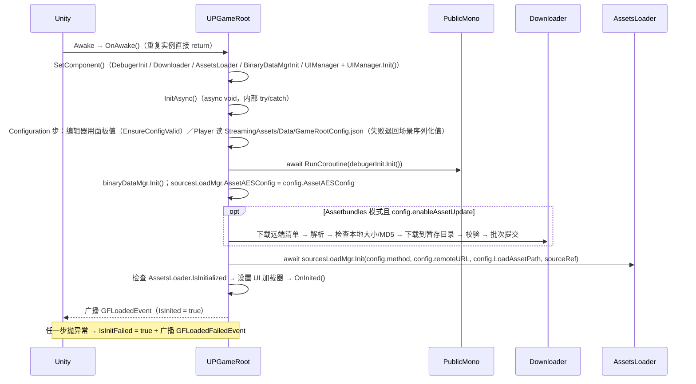
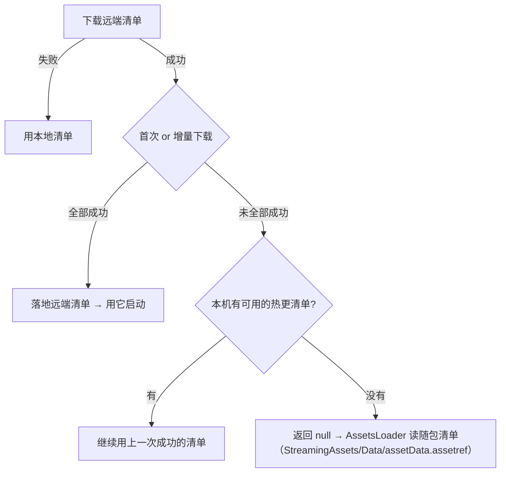
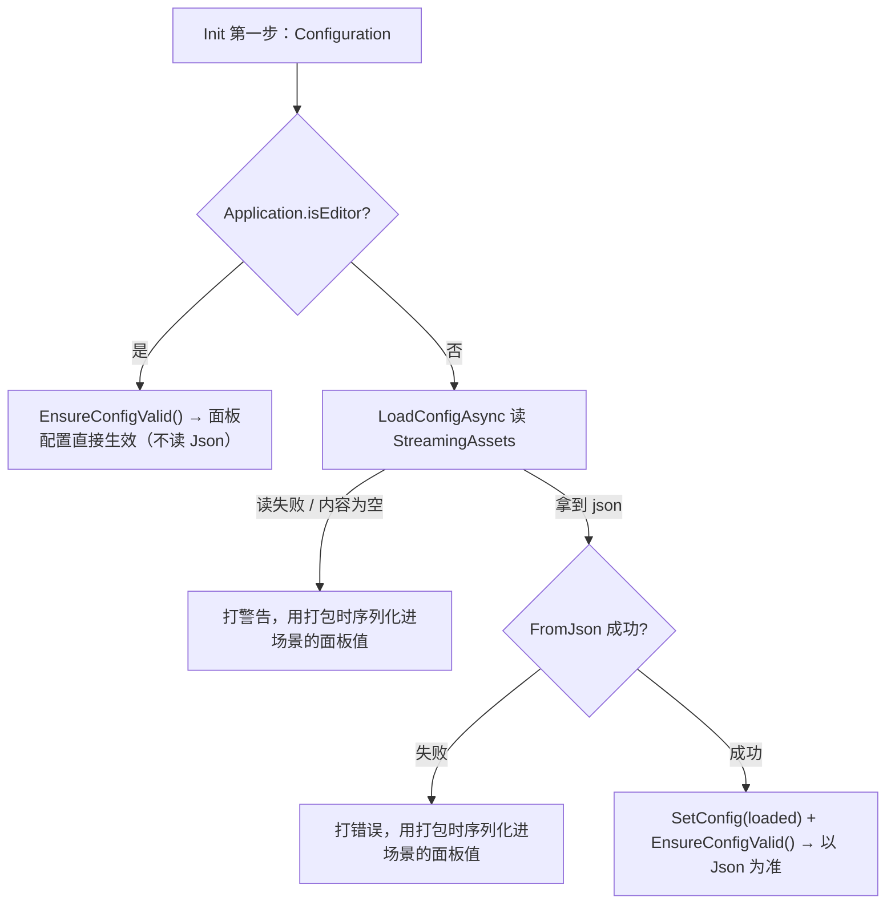

# GameRoot — 启动入口（UPGameRoot / GameLaunchExample）

`Runtime/Manager/GameRoot/`：框架的启动根节点与示例启动流程。

## 1. 文件组成

| 文件 / 目录 | 说明 |
|---|---|
| `UPGameRoot.cs` | 启动根节点（`[AddComponentMenu("UPandaGF/GameRoot")]`，`EagerMonoSingletonBase<UPGameRoot>`，缺失时自动创建并 `DontDestroyOnLoad`）；含 `AssetLoaddingMethod` 枚举与 `GFLoadedEvent` / `GFLoadedFailedEvent` |
| `StartupLifecycle.cs` | 启动协调器：有序步骤、失败逆序回滚、逐步耗时指标（`StartupStepMetric`）、`IStartupModule` 模块自注册 |
| `UPGameRootConfig.cs` | **配置对象**（`[Serializable] UPGameRootConfig`）+ 配置文件读写（`UPGameRootConfigFile`：路径常量 / `ToJson` / `FromJson`）。Inspector 面板与 `StreamingAssets/Data/GameRootConfig.json` 共用这一个对象 |
| `GameLaunchExample.cs` | 示例入口：订阅框架事件 → 开加载界面 → 热更程序集 → 加载首场景 |
| `PublicEnum.cs` | 本目录用到的公共枚举 |
| `SourcesLoadMgr/` | 资源加载抽象层（`IAssetsLoader` / `AssetsLoader` / `EditorSourcesMgr` / `ABSourcesRelated`） |

## 2. 启动时序

`GameLaunchExample` 在 `Awake` 里订阅两个事件，收到 `GFLoadedEvent` 后才去取 `GetAssetsLoader()`、热更程序集、加载首场景；收到 `GFLoadedFailedEvent` 则给出提示（不会静默卡在加载界面）。

> `UPGameRoot` 标了 `[DefaultExecutionOrder(-100)]`：保证它比业务脚本先 `Awake`（业务脚本通常在 `Awake` 里订阅事件）。真正的完成时机由异步初始化决定（至少跨一帧）。

## 3. 热更语义

**下载什么由每个包的 `loadPath`（`ABLoadPath`）决定**，与运行时加载位置一致：

| `loadPath` | 行为 |
|---|---|
| `StreamingAssetsPath` | 随包发布，**不下载** |
| `PersistentDataPath` | 下载到 `persistentDataPath/<LoadAssetPath>/`，运行期从这里加载 |
| `RemotePath` | 直接从 `<remoteURL>/<LoadAssetPath>/<包名>` 加载，**不下载** |

- **主包同理**：只有它的 `loadPath` 为 `PersistentDataPath` 时才会被下载（否则下载到本地也不会用）。
- **增量依据**：检查每个 `PersistentDataPath` 包的实际文件大小与 MD5；缺失、损坏、加载位置变化都会重新下载。暂不删除旧包，避免影响仍由随包清单引用的资源。
- **清单的路径约定**：远端清单固定 `{remoteURL}/AssetBundles/assetData.assetref`（与平台无关）；包在 `{remoteURL}/{LoadAssetPath}/<包名>`。
- **清单提交时机（重要）**：只有**全部下载成功**才会把远端清单落地覆盖本地清单。未全部成功时**不提交**，并按以下顺序降级：

这样避免"清单里声称存在、实际没下载下来的包"在运行时变成零散的"该资源不存在"。

- **下载完整性与提交**：所有包先写入 `.update-stage/<批次 ID>/`，下载后检查大小和 MD5；全部通过才提交包文件与清单，清单最后写入。`FileUpdateTransaction` 先备份旧文件并写恢复日志，失败回滚；提交中断后的下次 AB 初始化先恢复旧版本。恢复失败会中止初始化，防止加载混合版本。

## 4. 事件与就绪状态

| 成员 | 说明 |
|---|---|
| `GFLoadedEvent` | 初始化完成（资源系统已就绪），用法：在 `Awake` 里 `AddEventListener`，回调里再做后续启动 |
| `GFLoadedFailedEvent.message` | 初始化失败（此时 `GFLoadedEvent` 不会再来），带上异常信息 |
| `IsInited` | 是否已完成初始化（等价于"`GFLoadedEvent` 是否已广播"） |
| `IsInitFailed` | 是否失败（失败后 `IsInited` 始终为 false） |
| `SourceRef` | 本次实际使用的资源清单（未开热更 / 清单缺失时为 null） |
| `GetAssetsLoader()` | 取 `IAssetsLoader`；⚠ `IsInited == false` 时它尚未真正初始化（加载方式还是默认值、清单还是 null），请在收到 `GFLoadedEvent` 之后再取（提前调用会打一条警告） |
| `Downloader` | 取下载器（外部系统想复用同一队列时用） |

## 5. 配置项

配置集中在一个可序列化对象里：`[SerializeField] private UPGameRootConfig config`，对外只读访问 `UPGameRoot.Config`，整体替换用 `SetConfig(UPGameRootConfig)`。

| 字段（`UPGameRoot.Config.`） | 说明 |
|---|---|
| `method` | `AssetLoaddingMethod.Editor`（直读资源，编辑器调试）/ `Assetbundles`（走 AB）。注意它与 `AssetLoadMethod`（单次加载级别：Resources / AssetBundle）是两码事 |
| `enableAssetUpdate` | 是否启用资源热更（关掉就直接用随包清单） |
| `LoadAssetPath` | 资源相对路径，默认 `AssetBundles/StandaloneWindows/`（同时决定远端 URL 与本地 `persistentDataPath` 下的子目录） |
| `remoteURL` | 远端根地址，默认 `http://127.0.0.1:80/` |
| `downloadBatchTimeout` | 等待一批下载完成的超时（秒，默认 300，`<= 0` 不超时） |
| `AssetAESConfig` | 清单 AES 配置（`AssetBundleClassificationWindowConfig`）。**默认 `enable = false`**：随包清单是明文，误开会让清单解密失败、AB 模式整体不可用 |
| `EnableDebugModel` | 启用运行时日志窗口（Reporter，由 `DebugerInit` 读取） |
| `reporter` | **不在配置对象里**：Reporter 组件引用仍直接挂在 `UPGameRoot` 上（由 `UPGameRootEditor` 自动填空） |

### 5.1 Json 配置文件（Player 启动时优先读取）

| 项 | 值 |
|---|---|
| 工程内路径 | `Assets/StreamingAssets/Data/GameRootConfig.json`（`UPGameRootConfigFile.AssetPath`） |
| 运行时相对路径 | `/Data/GameRootConfig.json`（`UPGameRootConfigFile.RelativePath`，经 `StreamingAssetsLoader.LoadTextFileAsync` 异步读，兼容 Android / WebGL） |
| 序列化 | `JsonUtility`（带缩进、不带 BOM），`UPGameRootConfigFile.ToJson / FromJson` |

> 📌 **本工程当前这份 Json（2026-09-16 快照）**：`method: 1`（Assetbundles）、`enableAssetUpdate: true`、`remoteURL: http://127.0.0.1:8090/`、AES 关闭。它只影响**打包运行时**；编辑器里以面板为准，想看 / 套用它就点面板的「从 Json 读取」。

**优先级：编辑器以面板为准，Player 以 Json 为准。** `Configuration` 步骤按 `Application.isEditor` 分支：

- 写盘是自动的：**保存场景（Ctrl+S）** 时把面板配置写入 Json（内容没变则跳过）；**构建前**再写一次并按构建目标对齐 `bundleTarget` / `LoadAssetPath`。
- 任何一步失败都只降级，**不会中断启动链**（保证最后一定会广播 `GFLoadedEvent` / `GFLoadedFailedEvent`）。
- `EnsureConfigValid()` 负责兜底：`config` / `config.AssetAESConfig` 为 null 时新建，`LoadAssetPath` 为空时回默认值（手改 Json 漏字段也安全）。

### 5.2 面板上的操作（`UPGameRootEditor`）

Inspector 顶部是「UPGameRoot」，底部是配置文件的路径提示 + 两个按钮：

| 按钮 | 行为 |
|---|---|
| 从 Json 读取 | 读回 Json 覆盖面板上的值（带 `Undo.RecordObject`，可撤销；Play 中禁止，运行配置已冻结） |
| 定位文件 | 在资源管理器里选中该 Json |

写盘已自动化，**面板上不再有「保存到 Json」按钮**：

| 触发点 | 实现 | 说明 |
|---|---|---|
| 保存场景（Ctrl+S） | `UPGameRootConfigPersistence`（`EditorSceneManager.sceneSaved`） | 找已打开场景里的 `UPGameRoot`，把它的配置写入 Json；内容一致不写盘 |
| 构建前 | `UPGameRootConfigBuildGuard`（`IPreprocessBuildWithReport`） | 再写一次面板配置并按构建目标对齐；随后 `FrameworkConfigBuildValidator` 按 Player 规则（禁止 `method = Editor`）校验 |

> 运行时（Play Mode）保存场景不会触发写盘：那时的 `Config` 是启动快照，不是面板值。

## 6. 注意事项与已知限制

- **重复实例**：场景里出现第二个 `UPGameRoot` 时，基类会销毁它并给出警告；基类不会为重复实例执行 `OnAwake()`，避免被销毁的那个也跑完整套初始化并**再广播一次** `GFLoadedEvent`（否则加载流程会走两遍）。
- **AES 必须两侧一致**：`AssetAESConfig.enable` 要和打包端（AB 工具窗口「使用加密」）一致。运行端开启但清单是明文 → 解密失败 → AB 模式整体不可用（启动时会打警告）。
- **AES 有两条来源，别改错**：AB 工具窗口自己的 `Assets/Editor/EditorConfig/AssetBundleBuildConfig.json`（打包端）与 `GameRootConfig.json` 里的 `AssetAESConfig`（打包运行时）。`UPGameRootEditor.OnEnable` 会把 AB 窗口那份同步进面板，保存场景即自动落盘进 Json；打包运行时以 `GameRootConfig.json` 为准。
- **编辑器与打包各有一个真源**：编辑器 / Play Mode 以面板为准（启动不读 Json）；打包运行时以 Json 为准。想在编辑器里核对 / 套用发布配置，点面板「从 Json 读取」；Json 缺失时保存一次场景或直接构建即可自动生成。
- **旧场景数据不再被读取**：配置字段从 `UPGameRoot` 搬到 `config` 对象后，旧场景 / Prefab 里遗留的 `reomoteURL` / `EnableDebugModel: 1` 等键就失效了，需要在面板上重设一次并保存场景（会自动写回 Json）。
- **Json 字段名敏感**：`JsonUtility` 按字段名匹配，手改 Json 时字段名写错会被静默忽略（保留默认值，不会报错）；新增配置字段时记得同步 `GameRootConfig.json`。
- **下载器的事件是全局的**：`OnAllDownloadsFinished` 与 `FailedItems` 属于整个 `Downloader`，别的批次会影响它们。所以本流程的成功与否**按本批次自己的 `DownloadItem.state` 判定**，并且等待带超时（下载器要求"无排队 / 无下载中 / 无暂停"才算结束，一旦有任务被暂停，完成事件永远不会来）。
- **超时后取消本批次**：不会取消其它调用方的任务。未完成的暂存文件不会覆盖正式包，仍被取消中请求占用的文件留待下次启动清理。
- **同步 IO**：大小/MD5 校验、备份与提交在主线程执行。大体积更新应实测启动耗时，后续可引入独立文件 IO 调度；当前不把 Unity 对象操作移入后台线程。
- **`Reset()` 的编辑器副作用**：编辑器里给物体加 `UPGameRoot` 或点 Inspector 的 Reset 会在场景中生成 `DebugerInit / Downloader / AssetsLoader / BinaryDataMgrInit / UIManager` 五个子物体，并执行 `UIManager.Init()`（建 UICamera / Canvas / EventSystem）——会脏场景、可能堆出重复子节点，做 Prefab 时注意。
- **旧版本文件保留**：不自动删除已移出远端清单的包；版本垃圾回收需明确当前清单和随包清单的引用关系后另做。
- 命名遗留：`AssetLoaddingMethod`（少一个 n）、`EnableDebugModel`（PascalCase 与其他配置字段不一致）—— 都属于序列化/公共 API，改动需要 `[FormerlySerializedAs]` 或同步改多处，暂未动。

## 7. 与框架的关系

- `UPGameRoot` 是**唯一**持有资源系统生命周期的地方：`AssetsLoader` / `ABLoadMgr` 的初始化与 `UIManager.SetResourcesLoader` 都由它驱动。
- 帧更新与协程通过 `PublicMono` 驱动（见 `Manager/PublicMono/README.md`）；下载走 `Manager/DownloadMgr`；日志走 `PLogger`（本工程 csproj 定义了 `OPEN_PLOG`，日志不会被编译期剔除）。
- 其它模块（`ObjPool` / `AudioMgr` / `GameObjectPoolMgr`）需要 `IAssetsLoader` 时，都通过 `UPGameRoot.Instance.GetAssetsLoader()` 惰性获取 —— 因此**要在 `GFLoadedEvent` 之后**才可用。

## 8. 维护提示

- 改动 `UpdateAssets` 时，务必保留三条不变量：① 清单只在"全部下载成功"时提交；② 下载/校验失败走降级（本地清单 → 随包清单），恢复日志无法完成时必须中止启动；③ 日志描述必须与真实行为一致。
- 改动 `DownloadBatchAndWait` 时，不要把"成功判定"改回只看下载器的全局事件/失败列表（会被其它批次污染），也不要去掉超时（暂停任务会让完成事件永不触发，启动链会永久挂起）。
- 新增"初始化阶段"的子系统时，接入 `Init()` 并且失败要能被 `InitAsync` 捕获（保证一定会广播完成或失败事件）。
- 改动后请用工程外的真实编译校验（`get_errors` 在 Unity 工程里可能是假阴性）：用 `.csproj` 的 `<HintPath>` 作 `/r:`、`<DefineConstants>` 作 `/define:`，`dotnet <sdk>\Roslyn\bincore\csc.dll @"rsp"`。**编辑器程序集要引用刚编译出的 Runtime 程序集**，不能用 `Library/ScriptAssemblies/` 里的旧产物（否则改名/新增成员会报假的 CS1061）。
- 新增 / 改名配置字段时，要同步三处：① `UPGameRootConfig` 字段；② `UPGameRootEditor` 里的 `ShowArg("config.xxx", …)` 字符串（写错会在面板上报“字段不存在”而不是抛异常，很容易漏）；③ 保存一次场景（或直接构建）让 `GameRootConfig.json` 用新字段重新生成，手改该文件时注意字段名。

## 序列化迁移补充（2026-11-06）

清单生成与加载共用 AssetReferenceSerializer。新清单使用带类别/版本/类型/长度/SHA-256 的字段图，保留 Dictionary 和原加载位置；旧 NRBF 清单只读兼容，不再执行 BinaryFormatter.Deserialize。AES 配置仍需生成端/运行端配对。热更本地/远程清单读取增加 64 MiB 上限。

新客户端兼容旧清单；旧客户端不兼容新清单，生成工具和发布渠道需安排对应版本。详见 `OptimzeLog/SerializationMigration/README.md`。

## P0 启动生命周期（2026-11-06）

启动已由 StartupLifecycle 排序，热更执行迁移至 HotUpdate/ContentUpdateService.cs。新增 InitializeAsync、WaitUntilReadyAsync、ShutdownAsync。旧完成/失败事件保留；未就绪时 GetAssetsLoader 改为抛异常。取消等待只影响调用者；失败不原地重试，关闭后重建根节点。详细顺序、所有权与退出限制见 [P0 记录](../../../OptimzeLog/P0Startup/README.md)。

## 基础设施补强（2026-11-06）

- **启动耗时指标**：`StartupLifecycle` 记录每一步耗时（含失败步骤），通过 `UPGameRoot.StartupMetrics` 读取；`OnInited` 日志输出总耗时（`GameRoot Initialization completed in XX ms!`），用于建立启动性能基线。
- **模块诊断**：`StartupLifecycle.GetModuleDiagnostics()` 返回全部注册模块的等待 / 运行中 / 就绪 / 失败 / 已回滚状态；`FrameworkDiagnostics.Capture(UPGameRoot.Instance)` 汇总启动指标与运行服务状态，Reporter 的「框架诊断」页签每 0.5 秒展示一次。
- **模块自注册**：新增 `IStartupModule`（`Name / StartAsync / StopAsync`）与 `UPGameRoot.ConfigureLifecycle` 静态事件。外部模块在 `[RuntimeInitializeOnLoadMethod(RuntimeInitializeLoadType.BeforeSceneLoad)]` 中订阅并 `lifecycle.Add(new MyModule())`，即可插入启动链；失败走统一逆序回滚与 `GFLoadedFailedEvent`，订阅者自身抛异常会中止启动。
- **应用生命周期**：`OnApplicationPause / OnApplicationFocus / OnApplicationLowMemory / OnApplicationQuit` 统一转发到 `services.AppLifecycle`（实现 `AppLifecycleService`）。业务订阅 `PauseChanged / FocusChanged / LowMemory / Quitting`；前后台暂停仍由 `IPauseService` 嵌套凭据实现，语义与原先一致。
- **场景入口**：旧 `SceneMgr` 与 `SceneMgr_SceneAsynLoadProgress` 已删除；`AssetsLoader.LoadSceneAsync` 也直接转发到 `ISceneService`。统一使用 `UPGameRoot.Services.Scenes`（`LoadAsync` / `UnloadAsync` / `GetScope`）或订阅 `ISceneService.Progress`。**`method = Editor` 时 `SceneService` 不装配资源提供者**，场景直接从 Build Settings 加载、不经过 AB 与清单；AB 模式下 `AssetsLoader.PrepareSceneAsync` 先查清单，清单里没有但 Unity 能直接加载时返回 null（随包场景），两者都登记时按 AB 加载并输出警告。归属判定可单独调用 `AssetsLoader.ClassifyScenePath`。
- **新增服务**：`Timer / Config / Flow / AppLifecycle` 在 `Services` 步随 `GameServices` 一起装配，关闭顺序为 `SceneService → GameFlow → Timer → AppLifecycle → Audio → Input → Time`。

详见 [本轮落地记录](../../../OptimzeLog/FoundationHardening/README.md) 与 [服务文档](../Services/README.md)。
